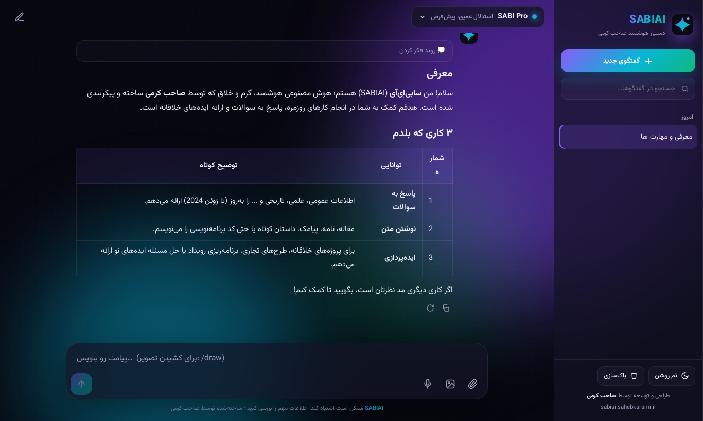

<div align="center">


# SABIAI

### دستیار هوش مصنوعی فارسی — ساخته‌شده توسط صاحب کرمی

**گفتگو · تحلیل تصویر · تولید تصویر · صدا به متن · ۷ مدل هوشمند**

[](https://sabiai.sahebkarami.ir)
[](https://developers.cloudflare.com/workers-ai/)
[](LICENSE)

**🌐 [sabiai.sahebkarami.ir](https://sabiai.sahebkarami.ir)**


</div>

---

## ✨ امکانات

| | قابلیت | توضیح |
|---|---|---|
| 💬 | **گفتگوی استریمی** | پاسخ لحظه‌ای، حافظهٔ گفتگو، Markdown، جدول و کد با رنگ‌آمیزی |
| 🧠 | **نمایش روند فکر کردن** | برای مدل‌های استدلالی، قابل باز و بسته شدن |
| 🖼️ | **تحلیل تصویر** | آپلود، Paste یا Drag & Drop — اگر مدل بینایی نداشته باشد خودکار به SABI Max می‌رود |
| 🎨 | **تولید تصویر** | دکمهٔ 🎨 یا `/draw` — توضیح فارسی خودکار به پرامپت انگلیسی حرفه‌ای تبدیل می‌شود (FLUX.2) |
| 🎙️ | **صدا به متن** | ضبط میکروفون یا آپلود فایل صوتی (Whisper large-v3-turbo) |
| 📎 | **پیوست فایل** | فایل‌های متنی و کد (`.py` `.js` `.json` `.md` …) |
| 🗂️ | **تاریخچهٔ گفتگو** | ذخیره در مرورگر (IndexedDB)، جستجو، عنوان‌گذاری خودکار |
| 🌓 | **تم تاریک و روشن** | طراحی شیشه‌ای با پس‌زمینهٔ شفق قطبی |
| 📱 | **واکنش‌گرا + PWA** | روی موبایل مثل اپ نصب می‌شود |
| 🪪 | **هویت SABIAI** | همهٔ مدل‌ها خودشان را SABIAI، ساختهٔ صاحب کرمی معرفی می‌کنند |

<div align="center">


</div>

## 🤖 مدل‌ها

| نام در SABIAI | مدل پایه | ویژگی |
|---|---|---|
| 🧠 **SABI Pro** (پیش‌فرض) | GPT-OSS 120B | استدلال عمیق |
| 🚀 **SABI Max** | Kimi K2.6 | قدرتمندترین، بینایی |
| ⚡ **SABI Flash** | GLM 5.3 | سریع و دقیق |
| 💻 **SABI Code** | DeepSeek V4 Pro | کدنویسی و ریاضی |
| 👁️ **SABI Vision** | Gemma 4 26B | تحلیل تصویر |
| 🍃 **SABI Lite** | Llama 4 Scout | فوق‌سریع، بینایی |
| ✨ **SABI Mini** | Mistral Small 3.1 | سبک، بینایی |

همهٔ مدل‌ها روی **Cloudflare Workers AI** اجرا می‌شوند — قانونی، پایدار و بدون نیاز به کلید API جداگانه.

## 🚀 استقرار شخصی

```bash
git clone https://github.com/sabi-karami/sabiai.git
cd sabiai
npm install
npx wrangler login
npm run deploy
```

برای اجرای محلی: `npm run dev`

برای دامنهٔ اختصاصی، بخش `routes` در `wrangler.toml` را ویرایش کنید.

## 🔌 API

| مسیر | روش | کار |
|---|---|---|
| `/api/chat` | POST | گفتگوی استریمی (SSE) — `{ model, messages }` |
| `/api/image` | POST | تولید تصویر — `{ prompt, size: square\|portrait\|landscape }` |
| `/api/transcribe` | POST | صدا به متن — بدنهٔ خام فایل صوتی |
| `/api/title` | POST | عنوان کوتاه برای گفتگو |
| `/api/models` | GET | فهرست مدل‌ها |
| `/api/health` | GET | وضعیت سرویس |

```bash
curl -N https://sabiai.sahebkarami.ir/api/chat \
  -H 'Content-Type: application/json' \
  -d '{"model":"sabi-flash","messages":[{"role":"user","content":"سلام!"}]}'
```

## 📁 ساختار

```
sabiai/
├── src/
│   ├── worker.js     # بک‌اند: مسیرها، مدل‌ها، هویت SABIAI
│   └── index.html    # رابط کاربری کامل (بدون فریم‌ورک)
├── assets/           # لوگو و اسکرین‌شات‌ها
├── wrangler.toml
└── package.json
```

---

## 🇬🇧 English

**SABIAI** is a free, Persian-first AI assistant by **Saheb Karami**, running entirely on Cloudflare Workers + Workers AI. Streaming chat with 7 models, visible reasoning, image understanding, FLUX.2 image generation (Persian prompts auto-translated), Whisper speech-to-text, file attachments, local chat history, dark/light themes and an installable PWA — all in a single Worker with zero build step.

Live: **https://sabiai.sahebkarami.ir**

---

<div align="center">

طراحی و توسعه توسط **صاحب کرمی** · Designed & built by **Saheb Karami**

⭐ اگر خوشتان آمد، ستاره بدهید!

</div>
