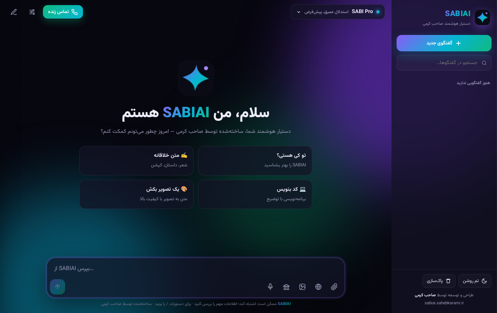
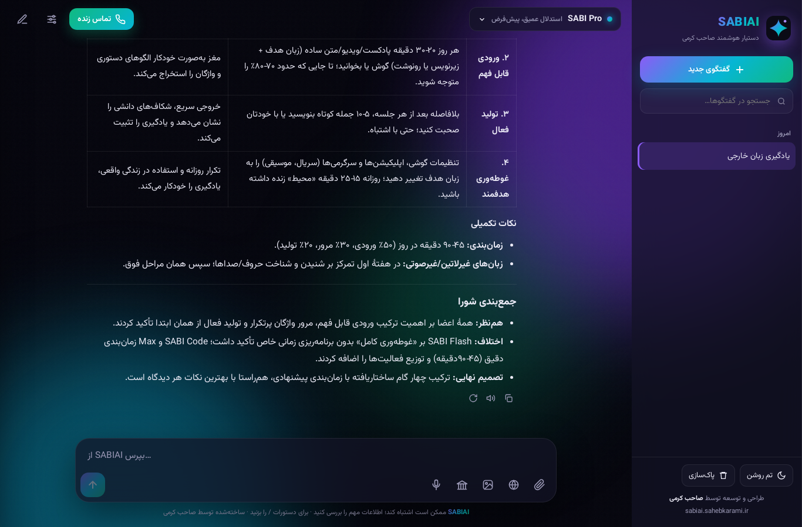
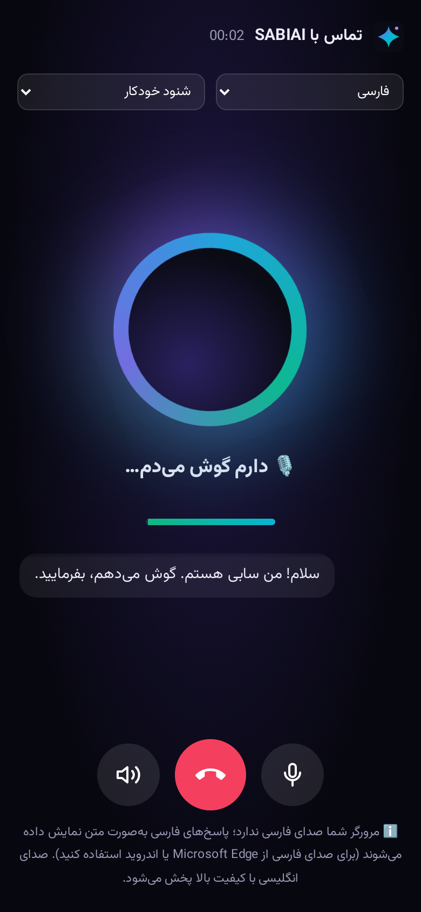
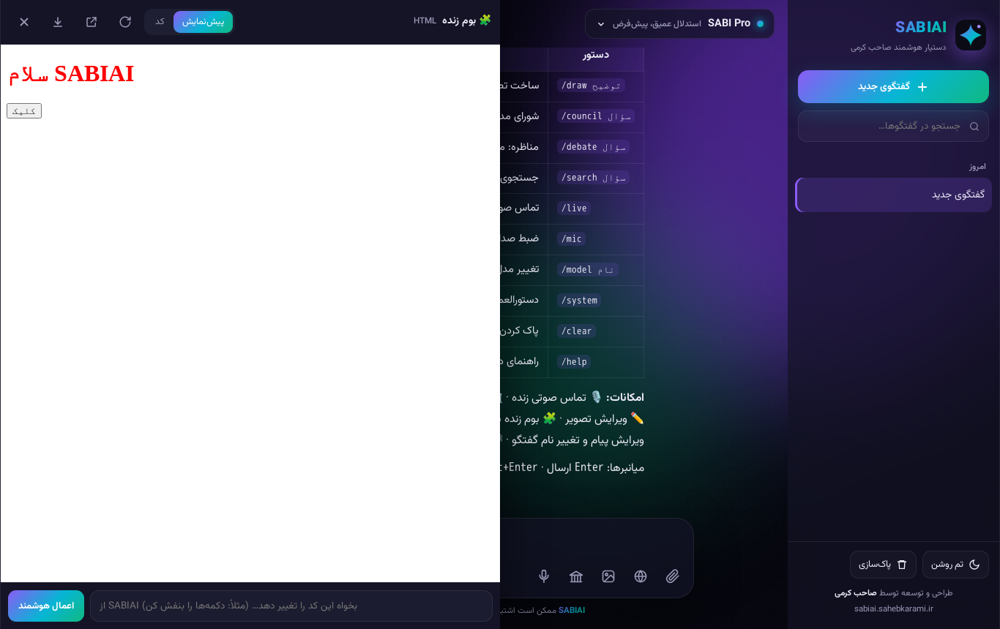
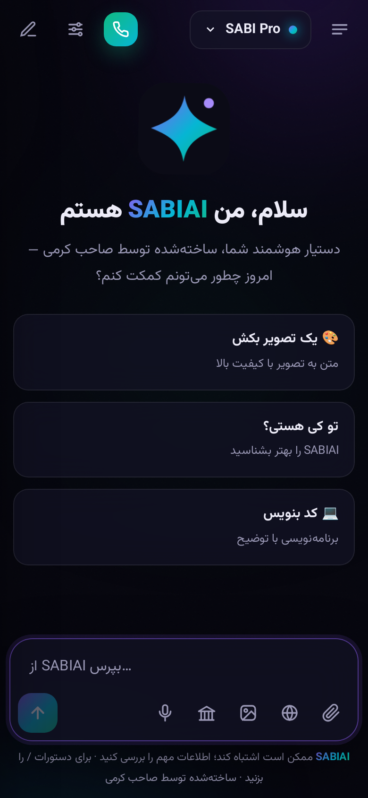

<div align="center">


# SABIAI · سابی‌اِی‌آی

**دستیار هوشمند فارسی — طراحی و توسعه توسط صاحب کرمی**

[🌐 sabiai.sahebkarami.ir](https://sabiai.sahebkarami.ir) · v2.0 · Cloudflare Workers AI · MIT



</div>

## ✨ امکانات

| | امکان | توضیح |
|---|---|---|
| 🎙️ | **تماس صوتی زنده** | گفتگوی صوتی دوطرفه با تشخیص خودکار سکوت (VAD)، حالت «فشار بده و حرف بزن»، قطع کردن صحبت (barge-in)، نقش سفارشی، ذخیرهٔ متن تماس در تاریخچه. Whisper → مدل → TTS به‌صورت جمله‌به‌جمله |
| 🏛️ | **شورای مدل‌ها** | سه مدل (Max, Code, Flash) همزمان فکر می‌کنند و SABI Pro به‌عنوان داور جمع‌بندی می‌کند؛ حالت «مناظره»: مدافع ← منتقد ← بی‌طرف ← داور |
| 🌐 | **جستجوی وب** | پاسخ با منبع و ارجاع [1]، خواندن لینک‌های داخل پیام، ویکی‌پدیای فارسی/انگلیسی (با کلید Tavily یا Brave کل وب) |
| 🎨 | **ساخت و ویرایش تصویر** | FLUX.2، پنج نسبت (1:1، 9:16، 3:4، 4:3، 16:9)، ویرایش هر تصویر با دستور فارسی، ترجمهٔ خودکار پرامپت |
| 🧩 | **بوم زنده (Canvas)** | اجرای کد HTML/JS/SVG در صفحه، ویرایش دستی، «اعمال هوشمند» تغییرات با زبان طبیعی، دانلود و بازکردن در برگه جدید |
| ⚙️ | **دستورالعمل و نقش** | نقش سفارشی برای هر گفتگو + ۸ الگوی آماده (معلم، برنامه‌نویس، مترجم، مصاحبه‌گر، …) |
| 🧠 | **۷ مدل SABI** | Pro (استدلال با نمایش روند فکر)، Max، Flash، Code، Vision، Lite، Mini |
| 👁️ | **بینایی** | تحلیل تا ۴ تصویر با سوئیچ خودکار به مدل بینا |
| ✏️ | **ویرایش پیام** | ویرایش و ارسال دوبارهٔ پیام، تولید دوباره، تغییر نام گفتگو |
| 🔊 | **خواندن با صدا** | پخش صوتی هر پاسخ |
| ⌨️ | **دستورات /** | `/draw` `/council` `/debate` `/search` `/live` `/mic` `/model` `/system` `/clear` `/help` |
| 📱 | **PWA** | نصب روی موبایل، تم تاریک/روشن، تاریخچهٔ محلی (IndexedDB) |

<div align="center">


<br/>


</div>

## 🚀 اجرا

```bash
npm i
npx wrangler login
npm run deploy        # روی sabiai.sahebkarami.ir منتشر می‌شود
# اختیاری — جستجوی کل وب:
npx wrangler secret put TAVILY_API_KEY   # یا BRAVE_API_KEY
```

## 🔌 API

| مسیر | کار |
|---|---|
| `POST /api/chat` | گفتگو (SSE) — `model`, `messages`, `search`, `system`, `voice` |
| `POST /api/council` | شورای مدل‌ها (SSE) — `question`, `mode: parallel\|debate` |
| `POST /api/image` | ساخت/ویرایش تصویر — `prompt`, `ratio`, `image?` |
| `POST /api/transcribe` | صدا به متن (Whisper) — `?lang=fa\|en\|auto` |
| `POST /api/tts` | متن به صدا (انگلیسی، Aura-2) |
| `POST /api/title` | عنوان خودکار گفتگو |
| `GET /api/models` · `/api/health` | فهرست مدل‌ها و وضعیت |

> **نکتهٔ صدا:** خروجی صوتی انگلیسی با Deepgram Aura-2 است. برای فارسی از صدای فارسی مرورگر استفاده می‌شود (بهترین نتیجه در Microsoft Edge و اندروید)؛ اگر مرورگر صدای فارسی نداشته باشد، پاسخ به‌صورت متن نمایش داده می‌شود.

---

## English

**SABIAI** is a Persian-first AI assistant built by **Saheb Karami** on Cloudflare Workers AI — one Worker, zero servers.

**v2 features:** live two-way voice calls (VAD, push-to-talk, barge-in), a council of models (3 models + judge, parallel or debate), web search with citations, FLUX.2 image generation in 5 aspect ratios plus image editing, a live HTML/JS canvas with natural-language patching, per-chat system prompts with presets, message editing, conversation renaming, read-aloud, slash commands, 7 branded models, vision, reasoning display, PWA.

License: MIT © Saheb Karami
